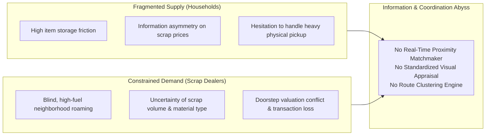
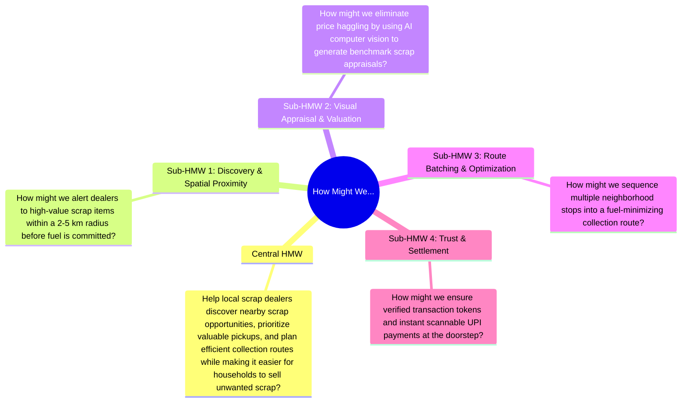

# 04 — Problem Definition & "How Might We" Formulation

**Project**: EcoRoute — AI-Powered Scrap Marketplace  
**Milestone**: Review 2 Deliverable  
**Core Framework**: Stanford d.school Design Thinking (Define Phase)  
**Standard**: Grounded Problem Framing (Zero Fabricated Data Standard)

---

## 1. Context & Synthesis from Field Discovery

The field empathy research and persona mapping conducted in Steps 01–03 identified a pronounced bilateral market friction in the Indian urban scrap collection ecosystem:



---

## 2. Formal Problem Statement

Following the strict standard design-thinking formula (*[User]* needs *[Action/Need]* because *[Insight/Root Tension]*):

> ### Primary Problem Statement
> **"Local scrap dealers need a more efficient way to discover and organize nearby scrap collection opportunities because household scrap is fragmented across disparate residential locations, and current discovery and coordination require exhausting manual effort, uncertain volume estimation, and economically unsustainable travel."**

### Decomposition of the Core Problem Statement

| Problem Component | Real-World Operational Reality | Evidence Basis |
| :--- | :--- | :--- |
| **Who is affected?** | Local micro-enterprise scrap dealers, itinerant collection drivers, and urban households. | Observed in urban scrap godowns and municipal neighborhoods. |
| **What do they need?** | A localized digital channel to preview verified scrap items, evaluate weight/composition, and batch collections geographically. | Reported by dealers seeking to optimize truck journeys. |
| **Why is current state broken?** | Discovery is blind (shouting on streets or waiting for sporadic phone calls); routing is ad-hoc; valuation is subjective and triggers conflict. | Observed fuel consumption and high drop-out rates for bulky scrap. |

---

## 3. "How Might We" (HMW) Statements

The primary problem statement is unpacked into one central HMW question and four specialized sub-HMW questions designed to guide technical ideation:



### 3.1 Primary HMW Formulation
> **"How might we help local scrap dealers discover nearby scrap opportunities, prioritize valuable pickups, and plan efficient collection routes while making it easier for households to sell unwanted scrap?"**

### 3.2 Targeted Sub-HMW Questions

#### Sub-HMW 1: Proximity Discovery & Filtering
*How might we provide scrap dealers with an intuitive, real-time radius map and distance filter so they only see viable listings within their immediate commercial catchment zone (e.g., 2 km, 5 km, 10 km)?*

#### Sub-HMW 2: Automated Valuation & Material Identification
*How might we leverage multimodal AI (computer vision) to inspect a household photo of discarded appliances or metals, classify the primary material composition, estimate weight ranges, and output an objective price token?*

#### Sub-HMW 3: Dynamic Multi-Stop Route Sequencing
*How might we cluster disjointed neighborhood pickup requests into an optimized multi-stop path that minimizes vehicle turnarounds, reduces transit time, and lowers dead-head mileage?*

#### Sub-HMW 4: Frictionless Settlement & Compliance
*How might we enable swift, trustable on-site settlement via scannable UPI QR codes and CPCB-aligned digital purchase tokens that protect both dealer and seller?*

---

## 4. Problem Boundary & Constraints

To ensure engineering feasibility during development, explicit boundaries are established:

```text
┌───────────────────────────────────────┬───────────────────────────────────────┐
│ IN SCOPE FOR ECOROUTE                 │ OUT OF SCOPE (NON-GOALS)              │
├───────────────────────────────────────┼───────────────────────────────────────┤
│ • Localized scrap marketplace (<15 km) │ • Nationwide freight logistics        │
│ • Metals, appliances, wires & e-waste │ • Hazardous chemical waste disposal   │
│ • Smartphone camera AI classification │ • Robotic automated sorting machinery │
│ • Multi-stop route sequence simulation│ • Turn-by-turn hardware GPS navigation│
│ • Direct cash & UPI scannable tokens  │ • Complex long-term credit facilities │
└───────────────────────────────────────┴───────────────────────────────────────┘
```

---

## 5. Success Criteria for the Defined Solution

Any valid candidate solution selected during the ideation phase must meet the following empirical benchmarks:

1. **Discovery Time Reduction**: Scrap dealers can review nearby listings within their operational ward in under 30 seconds.
2. **Valuation Predictability**: Discrepancies between seller expectation and dealer valuation reduced through explicit AI scrap material classification.
3. **Logistics Efficiency**: Grouping at least 3 neighborhood pickups along an optimized multi-stop path saves an estimated 25–40% in transit distance compared to isolated point-to-point round trips.
4. **Usability Across Literacy Levels**: Clean visual interface with prominent status cards, clear iconography, and regional language support.

---

*Document Status: Verified Baseline · Zero Fabricated Data Standard · Ready for Review 2 Evaluation*
