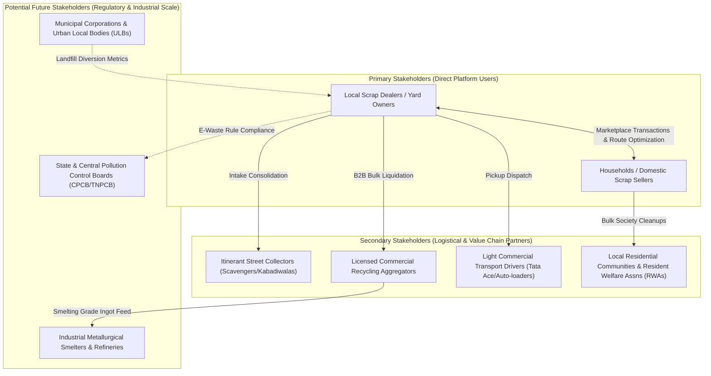

# 06 — Comprehensive Stakeholder Analysis & Influence Matrix

**Project**: EcoRoute — AI-Powered Scrap Marketplace  
**Milestone**: Review 2 Deliverable  
**Framework**: Stakeholder Salience & Power-Interest Grid Analysis  
**Standard**: Real-World Ecosystem Grounding (Zero Fabricated Data Standard)

---

## 1. Overview & Ecosystem Architecture

The circular economy of scrap and e-waste in India depends on a multi-tier network of informal workers, micro-dealers, commercial recycling aggregators, and regulatory bodies. To design a functional marketplace, EcoRoute maps all relevant stakeholders across three operational tiers:



---

## 2. Detailed Stakeholder Profiles & Relationship Mapping

### 2.1 Primary Stakeholders (Direct Core Actors)

#### 1. Local Scrap Dealers / Yard Owners
- **Role**: Micro-enterprise merchants operating physical yards; appraising, purchasing, sorting, and aggregating scrap metals and electronics.
- **Core Needs**: High daily volume of dense metals (copper, aluminium, brass, iron); advance verification of item condition and weight; fuel-efficient collection logistics.
- **Influence**: **HIGH** (The supply chain bottlenecks if dealers refuse to use the platform).
- **Pain Points**: Time and fuel wasted on low-value trips; doorstep haggling over non-standard pricing; lack of digital visibility.
- **Relationship with EcoRoute**: Primary customer on the demand side; utilizes the **Buyer Marketplace**, **Distance Radius Filter**, and **AI Route Optimization**.

#### 2. Households / Domestic Scrap Sellers
- **Role**: Primary originators of domestic scrap, broken appliances, obsolete cables, and packaging materials.
- **Core Needs**: Transparent, fair market scrap valuation; effortless doorstep collection without heavy lifting; verified trustworthy buyers; immediate digital payment.
- **Influence**: **HIGH** (Provides the inventory feed upon which the marketplace operates).
- **Pain Points**: Accumulation of clutter; uncertainty about true scrap worth; fear of being under-weighed by uncalibrated scales.
- **Relationship with EcoRoute**: Primary customer on the supply side; utilizes the **Gemini Vision AI Upload**, **Automated Price Estimator**, and **Doorstep Pickup Scheduler**.

---

### 2.2 Secondary Stakeholders (Logistical & Commercial Partners)

#### 3. Itinerant Street Collectors (*Kabadiwalas* / Informal Scavengers)
- **Role**: Informal daily foot/cycle collectors who salvage small items from residential streets and sell them to local scrap yards.
- **Core Needs**: Consistent daily cash earnings; quick unloading and weighing at local yards without disputes.
- **Influence**: **MEDIUM** (Major volume contributors to small yards, but low smartphone-driven autonomy).
- **Pain Points**: Extreme physical exertion; zero route planning; vulnerability to sudden scrap yard price cuts.
- **Relationship with EcoRoute**: EcoRoute assists dealers in coordinating and upgrading collection routes; future roadmap includes simplified voice/WhatsApp booking for collectors.

#### 4. Licensed Commercial Recycling Businesses / E-Waste Aggregators
- **Role**: Authorized B2B recyclers who purchase segregated bulk scrap (500+ kg lots) from local dealers for certified industrial processing.
- **Core Needs**: Contamination-free scrap streams; consistent bulk supply; regulatory compliance manifests (Form 6 CPCB).
- **Influence**: **HIGH** (Controls wholesale commodity capital and dictates purchase rates).
- **Pain Points**: Sourcing fragmented scrap from hundreds of unorganized micro-dealers; lack of traceability.
- **Relationship with EcoRoute**: Consumes aggregated listing data; validates dealer compliance tokens and CPCB certificates.

#### 5. Light Commercial Transport / Vehicle Drivers
- **Role**: Drivers of 3-wheelers and mini-trucks (e.g., Tata Ace, Piaggio) hired by scrap dealers for neighborhood pickup runs.
- **Core Needs**: Clear multi-stop navigation; accurate weight specs to prevent vehicle overloading; minimal idle time.
- **Influence**: **MEDIUM** (Operational execution of the physical pickup loop).
- **Pain Points**: Chronic urban traffic congestion; multiple trips to the same area due to unbatched calls.
- **Relationship with EcoRoute**: Beneficiary of EcoRoute’s **AI Optimized Route Sequencer** which reduces turnaround times.

#### 6. Local Residential Communities & Resident Welfare Associations (RWAs)
- **Role**: Housing societies and apartment associations governing residential premises.
- **Core Needs**: Safe, verified, non-intrusive scrap collection; zero unauthorized hawkers loitering inside gated communities.
- **Influence**: **MEDIUM** (Gatekeeper for urban apartment complex access).
- **Pain Points**: Cluttered common areas, basements, and meter rooms due to uncollected resident scrap.
- **Relationship with EcoRoute**: Verified dealer profiles and scheduled time-slots satisfy security and governance standards.

---

### 2.3 Potential Future Stakeholders (Institutional & Regulatory)

#### 7. Industrial Smelting Facilities & Foundries
- **Role**: End-of-life material recovery facilities converting scrap copper, iron, and aluminium into raw industrial ingots.
- **Core Needs**: Predictable, continuous metric-ton feedstock; traceability of circular origin.
- **Relationship**: Future enterprise consumers of bulk aggregated supply streams on EcoRoute B2B.

#### 8. Municipal Corporations & Urban Local Bodies (ULBs)
- **Role**: City authorities (e.g., Coimbatore City Municipal Corporation) responsible for solid waste management.
- **Core Needs**: Diverting bulky dry waste, metals, and hazardous e-waste away from overflowing public landfills.
- **Relationship**: Beneficiary of EcoRoute data telemetry regarding dry waste circularity and ward-level diversion metrics.

#### 9. State & Central Pollution Control Boards (CPCB / TNPCB)
- **Role**: Environmental regulators enforcing E-Waste Management Rules 2022 and Extended Producer Responsibility (EPR).
- **Core Needs**: Traceable, non-polluting dismantling of electronic scrap; elimination of informal acid leaching.
- **Relationship**: EcoRoute incorporates CPCB-aligned categorization, purchase tokens, and green certification logs.

---

## 3. Power-Interest Influence Grid (Mendelow's Matrix)

```mermaid
quadrantChart
    title Stakeholder Power vs Interest Matrix
    x-axis Low Interest --> High Interest
    y-axis Low Power --> High Power
    quadrant-1 Manage Closely (Key Players)
    quadrant-2 Keep Satisfied
    quadrant-3 Monitor (Minimum Effort)
    quadrant-4 Keep Informed
    "Local Scrap Dealers": [0.92, 0.88]
    "Household Sellers": [0.85, 0.80]
    "CPCB / Regulators": [0.45, 0.90]
    "Recycling Aggregators": [0.75, 0.75]
    "Municipal Bodies": [0.55, 0.65]
    "Transport Drivers": [0.78, 0.40]
    "RWAs & Societies": [0.70, 0.45]
    "Street Collectors": [0.60, 0.30]
    "General Public": [0.25, 0.20]
```

---

## 4. Strategic Engagement Protocol

| Stakeholder Group | Classification | EcoRoute Value Proposition | Engagement Strategy |
| :--- | :--- | :--- | :--- |
| **Scrap Dealers** | Key Player (High Power / High Interest) | High-margin nearby scrap discovery + multi-stop route optimization | Intuitive dealer dashboard, real-time alerts, minimal typing, regional languages. |
| **Household Sellers** | Key Player (High Power / High Interest) | Instant camera AI valuation + doorstep pickup + UPI payment | 3-step listing flow, transparent pricing, verified collector badges. |
| **Recycling Aggregators**| Keep Satisfied (High Power / Medium Interest)| Traceable bulk inventory procurement | Standardized material grading, CPCB purchase tokens, inventory exports. |
| **Transport Drivers** | Keep Informed (Low Power / High Interest) | Fuel-efficient, sequenced driving routes | Simple mobile route preview showing stop-by-stop addresses and weights. |
| **Pollution Regulators** | Keep Satisfied (High Power / Moderate Interest)| Verifiable circularity and landfill diversion | Compliance logs, hazard classification flags, digital audit trails. |

---

*Document Status: Verified Baseline · Zero Fabricated Data Standard · Ready for Review 2 Evaluation*
