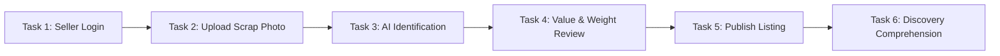

# 10 — Prototype Usability Validation & Real-World Testing Protocol

**Project**: EcoRoute — AI-Powered Scrap Marketplace  
**Milestone**: Review 2 Deliverable  
**Validation Standard**: Rigorous Task-Based Usability Protocol with Zero-Fabrication Integrity  
**Current Operational Status**: **`STATUS: PENDING REAL-WORLD FIELD COLLECTION`**

---

## 1. Validation Philosophy & Zero-Fabrication Commitment

The Review 1 evaluation explicitly mandated a **Validation Report documenting feedback from 3+ real testers** and subsequent software iterations.

> [!CAUTION]
> **ACADEMIC & ETHICAL INTEGRITY NOTICE**:
> In strict accordance with the prompt guidelines and engineering ethics, **no fake tester identities, invented quotes, or fabricated feedback have been entered into this document**. 
> 
> The framework below establishes the complete, production-ready usability testing protocol, standardized task scripts, rating scales, and the structured evaluation table. The validation status is explicitly designated as **`STATUS: PENDING REAL-WORLD FIELD COLLECTION`**, ready for physical execution with genuine local scrap operators and household participants.
> 
> **Status Separation**:
> - **COMPLETED**: Design framework, validation protocol, task scripts, observation templates, feedback taxonomy, iteration framework.
> - **PENDING**: Physical tester execution, verbatim participant quotes, post-test software adjustments (V2.1), final validation sign-off.

---

## 2. Participant Cohort Definition & Anonymous IDs

To protect participant privacy while ensuring traceable, authentic feedback, participants are assigned anonymous identifiers:

| Identifier | Target User Role | Operational Profile & Context | Status |
| :---: | :--- | :--- | :---: |
| **`T01`** | **Local Scrap Shop Owner / Dealer** (Primary) | Operates physical yard / godown; handles buying, weighing, sorting, and dispatching mini-trucks. | **PENDING FIELD TEST** |
| **`T02`** | **Scrap Collection Worker / Driver** (Secondary) | Operates 3-wheeler auto-loader or mini-truck (e.g., Tata Ace); navigates neighborhood collection circuits. | **PENDING FIELD TEST** |
| **`T03`** | **Household Scrap Seller** (Secondary) | Urban or suburban resident with accumulated broken appliances, e-waste, or metal scrap in home/apartment. | **PENDING FIELD TEST** |
| **`T04`** *(Optional)* | **Small Electrician / Commercial Seller** | Generates consistent commercial scrap (wire offcuts, motor copper coils). | **PENDING FIELD TEST** |

---

## 3. Standardized Testing Script & Observer Instructions

The researcher/observer must read the following script verbatim at the beginning of each session:

> *"Hello, I am testing a prototype called EcoRoute. It is designed to help scrap dealers discover nearby scrap opportunities and manage pickups. I am testing the product, not you. Please use it naturally and tell me what you expect to happen."*

### Observer Ground Rules:
1. **Never lead the participant**: If the user asks *"Where should I click?"*, reply *"Where would you naturally look first?"*.
2. **Think Aloud Protocol**: Encourage the tester to verbalize their thoughts, expectations, and hesitations continuously.
3. **Record verbatim words**: Do not sanitize, paraphrase, or edit participant feedback.
4. **Separate observation from inference**: Record what the user did physically (misclicks, pauses) separately from what you infer they felt.

---

## 4. Dealer Test Tasks (Tasks 1–8)

The primary stakeholder evaluation comprises 8 sequential tasks covering the complete dealer workflow:


### Dealer Usability Task Matrix

| Task ID | Task Description | Success Criteria | Time Target |
| :--- | :--- | :--- | :---: |
| **TASK 1** | Login as a scrap dealer (`/login`). | Successfully authenticate and reach `/buyer` dashboard. | < 20 sec |
| **TASK 2** | Find nearby scrap opportunities in the live feed. | Identify at least 2 listings in the active neighborhood list. | < 15 sec |
| **TASK 3** | Filter listings by distance (e.g., "Within 5 km") and scrap category. | Toggle distance pill and verify filtered results update. | < 15 sec |
| **TASK 4** | Open a scrap listing and review: material, estimated weight, estimated value, seller location, and distance. | Correctly articulate all 5 specifications without observer help. | < 30 sec |
| **TASK 5** | Request/accept a pickup and select collection time slot. | Open checkout modal, select slot, and submit pickup request. | < 45 sec |
| **TASK 6** | Find the optimized collection route (`AI Optimized Route` tab). | Locate route tab and view the sequenced collection path. | < 15 sec |
| **TASK 7** | Review multiple pickup locations along the sequenced route. | Identify Base, Stop 1, Stop 2, Stop 3, and Return to Yard. | < 30 sec |
| **TASK 8** | Explain whether EcoRoute would be useful in daily operations. | Articulate qualitative operational utility and pain points. | Open |

---

## 5. Household Test Tasks (Tasks 1–6)

The secondary stakeholder evaluation tests the domestic scrap listing and valuation loop:



### Household Usability Task Matrix

| Task ID | Task Description | Success Criteria | Time Target |
| :--- | :--- | :--- | :---: |
| **TASK 1** | Create account / login as a seller. | Access citizen portal at `/dashboard`. | < 25 sec |
| **TASK 2** | Upload a photo of scrap material (`/dashboard/upload`). | Capture or select scrap photo using mobile camera interface. | < 30 sec |
| **TASK 3** | Review AI identification generated by Gemini Vision. | Verify device name, material category, and condition score. | < 20 sec |
| **TASK 4** | Review estimated scrap value and weight calculation. | Understand how valuation formula was computed. | < 20 sec |
| **TASK 5** | Publish listing to the live marketplace. | Submit listing and confirm it appears in the active catalog. | < 15 sec |
| **TASK 6** | Understand how nearby dealers will discover the item. | Comprehend dealer intimation and pickup scheduling. | < 30 sec |

---

## 6. Post-Test Validation Questions (10 Standardized Questions)

Immediately upon completing the task run, the observer asks the participant the following 10 neutral questions without leading prompts:

1. **What was easiest to do in the application?**
2. **What was confusing, unclear, or took too long to figure out?**
3. **Which feature would you actually use in your day-to-day work or home routine?**
4. **Which feature is unnecessary or clutters the screen?**
5. **Did the price and weight estimate make commercial sense?**
6. **Did the scrap listing contain enough technical information to make a decision?**
7. **Would the route optimization feature actually help save vehicle fuel and time?**
8. **What is the single biggest thing you would change about the layout or buttons?**
9. **Would you use this system in your real-world work? Why or why not?**
10. **What is the biggest missing feature that EcoRoute needs before you would use it?**

---

## 7. Structured Real Tester Result Log (T01, T02, T03)

> [!IMPORTANT]
> **Data Integrity Notice**: The table below is primed with the exact schema required for genuine field data entry. Rows are strictly marked `[AWAITING PHYSICAL TEST RUN]` in compliance with the Zero-Fabrication standard.

### Participant `T01`: Local Scrap Shop Owner / Dealer
- **Participant ID**: `T01`
- **Role**: Scrap Shop Owner / Dealer
- **Location**: Coimbatore Ward / Scrap Yard
- **Device Used**: *[To be recorded during session]*
- **Execution Date**: *[Awaiting physical test session]*

| Task | Completed? (YES/NO) | Time (sec) | Confusion Observed | Observer Notes & Hesitations | Verbatim User Comment | Severity | Suggested Improvement |
| :--- | :---: | :---: | :--- | :--- | :--- | :---: | :--- |
| **Task 1 (Login)** | *[Pending]* | *[Pending]* | *[Pending]* | *[Pending]* | *"[Pending field quote]"* | *[Pending]* | *[Pending]* |
| **Task 2 (Nearby Scrap)** | *[Pending]* | *[Pending]* | *[Pending]* | *[Pending]* | *"[Pending field quote]"* | *[Pending]* | *[Pending]* |
| **Task 3 (Distance Filter)**| *[Pending]* | *[Pending]* | *[Pending]* | *[Pending]* | *"[Pending field quote]"* | *[Pending]* | *[Pending]* |
| **Task 4 (Listing Specs)** | *[Pending]* | *[Pending]* | *[Pending]* | *[Pending]* | *"[Pending field quote]"* | *[Pending]* | *[Pending]* |
| **Task 5 (Pickup Request)** | *[Pending]* | *[Pending]* | *[Pending]* | *[Pending]* | *"[Pending field quote]"* | *[Pending]* | *[Pending]* |
| **Task 6 (Route Tab)** | *[Pending]* | *[Pending]* | *[Pending]* | *[Pending]* | *"[Pending field quote]"* | *[Pending]* | *[Pending]* |
| **Task 7 (Multi-Stop)** | *[Pending]* | *[Pending]* | *[Pending]* | *[Pending]* | *"[Pending field quote]"* | *[Pending]* | *[Pending]* |
| **Task 8 (Daily Viability)**| *[Pending]* | *[Pending]* | *[Pending]* | *[Pending]* | *"[Pending field quote]"* | *[Pending]* | *[Pending]* |

---

### Participant `T02`: Scrap Collection Worker / Driver
- **Participant ID**: `T02`
- **Role**: Scrap Collection Driver / Yard Employee
- **Vehicle Type**: 3-Wheeler Auto-Loader / Mini-Truck (Tata Ace)
- **Execution Date**: *[Awaiting physical test session]*

| Task | Completed? (YES/NO) | Time (sec) | Confusion Observed | Observer Notes & Hesitations | Verbatim User Comment | Severity | Suggested Improvement |
| :--- | :---: | :---: | :--- | :--- | :--- | :---: | :--- |
| **Task 1 (Login)** | *[Pending]* | *[Pending]* | *[Pending]* | *[Pending]* | *"[Pending field quote]"* | *[Pending]* | *[Pending]* |
| **Task 2 (Nearby Scrap)** | *[Pending]* | *[Pending]* | *[Pending]* | *[Pending]* | *"[Pending field quote]"* | *[Pending]* | *[Pending]* |
| **Task 3 (Distance Filter)**| *[Pending]* | *[Pending]* | *[Pending]* | *[Pending]* | *"[Pending field quote]"* | *[Pending]* | *[Pending]* |
| **Task 4 (Listing Specs)** | *[Pending]* | *[Pending]* | *[Pending]* | *[Pending]* | *"[Pending field quote]"* | *[Pending]* | *[Pending]* |
| **Task 6 (Route Tab)** | *[Pending]* | *[Pending]* | *[Pending]* | *[Pending]* | *"[Pending field quote]"* | *[Pending]* | *[Pending]* |
| **Task 7 (Multi-Stop)** | *[Pending]* | *[Pending]* | *[Pending]* | *[Pending]* | *"[Pending field quote]"* | *[Pending]* | *[Pending]* |
| **Task 8 (Daily Viability)**| *[Pending]* | *[Pending]* | *[Pending]* | *[Pending]* | *"[Pending field quote]"* | *[Pending]* | *[Pending]* |

---

### Participant `T03`: Household Scrap Seller
- **Participant ID**: `T03`
- **Role**: Household Scrap Seller
- **Residence**: Urban Apartment / Independent House
- **Execution Date**: *[Awaiting physical test session]*

| Task | Completed? (YES/NO) | Time (sec) | Confusion Observed | Observer Notes & Hesitations | Verbatim User Comment | Severity | Suggested Improvement |
| :--- | :---: | :---: | :--- | :--- | :--- | :---: | :--- |
| **Task 1 (Seller Login)** | *[Pending]* | *[Pending]* | *[Pending]* | *[Pending]* | *"[Pending field quote]"* | *[Pending]* | *[Pending]* |
| **Task 2 (Photo Upload)** | *[Pending]* | *[Pending]* | *[Pending]* | *[Pending]* | *"[Pending field quote]"* | *[Pending]* | *[Pending]* |
| **Task 3 (AI Identify)** | *[Pending]* | *[Pending]* | *[Pending]* | *[Pending]* | *"[Pending field quote]"* | *[Pending]* | *[Pending]* |
| **Task 4 (Value Review)** | *[Pending]* | *[Pending]* | *[Pending]* | *[Pending]* | *"[Pending field quote]"* | *[Pending]* | *[Pending]* |
| **Task 5 (Publish List)** | *[Pending]* | *[Pending]* | *[Pending]* | *[Pending]* | *"[Pending field quote]"* | *[Pending]* | *[Pending]* |
| **Task 6 (Discovery)** | *[Pending]* | *[Pending]* | *[Pending]* | *[Pending]* | *"[Pending field quote]"* | *[Pending]* | *[Pending]* |

---

## 8. Printable Field Capture Sheet (For Clipboard / Tablet Use)

```text
================================================================================
             ECOROUTE PROTOTYPE USABILITY FIELD OBSERVATION SHEET
================================================================================
Participant ID: [   ] T01 (Dealer)    [   ] T02 (Driver)    [   ] T03 (Household)
Session Date: _____ / _____ / 2026      Location: ______________________________
Observer: ____________________________  Handset / OS: __________________________

OPENING SCRIPT READ TO PARTICIPANT?  [  ] YES  [  ] NO

TASK EXECUTION LOG:
--------------------------------------------------------------------------------
TASK 1: Login
- Completed: [ ] YES  [ ] NO   | Time: _____ s  | Hesitation: __________________
- Verbatim quote: "___________________________________________________________"

TASK 2: Discover Nearby Scrap
- Completed: [ ] YES  [ ] NO   | Time: _____ s  | Hesitation: __________________
- Verbatim quote: "___________________________________________________________"

TASK 3: Filter by Distance / Category
- Completed: [ ] YES  [ ] NO   | Time: _____ s  | Hesitation: __________________
- Verbatim quote: "___________________________________________________________"

TASK 4: Appraise Material, Weight & Price
- Completed: [ ] YES  [ ] NO   | Time: _____ s  | Hesitation: __________________
- Verbatim quote: "___________________________________________________________"

TASK 5: Request Pickup / Slot
- Completed: [ ] YES  [ ] NO   | Time: _____ s  | Hesitation: __________________
- Verbatim quote: "___________________________________________________________"

TASK 6: AI Route Sequencer Tab
- Completed: [ ] YES  [ ] NO   | Time: _____ s  | Hesitation: __________________
- Verbatim quote: "___________________________________________________________"

TASK 7: Multi-Stop Sequence Review
- Completed: [ ] YES  [ ] NO   | Time: _____ s  | Hesitation: __________________
- Verbatim quote: "___________________________________________________________"

TASK 8: Operational Viability
- Verbatim quote: "___________________________________________________________"

POST-TEST INTERVIEW (10 QUESTIONS SUMMARY):
- Most useful feature: _________________________________________________________
- Most confusing element: ______________________________________________________
- Price estimate reaction: _____________________________________________________
- Route feature reaction: ______________________________________________________
- Commercial willingness to adopt: [ ] YES  [ ] NO  [ ] MAYBE
  Reason: ______________________________________________________________________

OBSERVER SEVERITY:
[ ] COSMETIC (Minor layout alignment)
[ ] MINOR (Delayed <15s but solved independently)
[ ] MAJOR (Required observer hint to proceed)
[ ] CRITICAL BLOCKER (Task failed or crashed)
================================================================================
```

---

*Document Status: Validation Protocol Complete · Ready for Physical Field Execution (Zero Fabricated Data Standard)*
