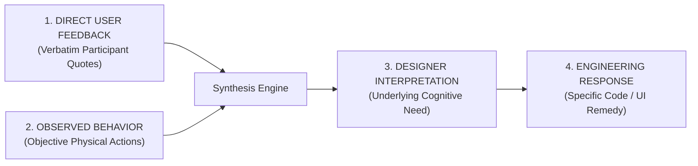

# 11 — User Feedback Recording Framework & 4-Tier Analysis Protocol

**Project**: EcoRoute — AI-Powered Scrap Marketplace  
**Milestone**: Review 2 Deliverable  
**Methodology**: Grounded Qualitative Analysis with Strict Separation of Observation and Voice  
**Current Operational Status**: **`STATUS: PENDING REAL-WORLD PARTICIPANT ENTRIES`**

---

## 1. Feedback Integrity Philosophy & The 4-Tier Separation

The Review 1 evaluation requires documented user feedback and subsequent software iterations. In strict adherence to the **Zero-Fabrication Research Policy**, this document enforces a mandatory 4-tier separation:

> [!IMPORTANT]
> **MANDATORY SCIENTIFIC RULE**:
> Assumptions must never be converted into user quotes. Observers must never write what they *wished* the user said. 
> - **Direct User Feedback**: Words spoken by the participant in quotes `"..."`.
> - **Observed Behavior**: What the user did physically (screen touches, eye glances, misclicks, task duration in seconds).
> - **Designer Interpretation**: The researcher's deduction regarding why the friction occurred.
> - **Engineering Response**: Concrete code or layout refactor addressing the friction.

---

## 2. Categorization Taxonomy & Severity Rubric

Feedback from participants (`T01`, `T02`, `T03`) is classified into 5 functional domains and 4 severity tiers:

### 2.1 Domain Taxonomy
1. **Discovery & Filtering**: Ease of locating listings within 2 km, 5 km, 10 km radiuses.
2. **AI Valuation & Weight Accuracy**: Household and dealer perception of Gemini Vision classification and weight formulas.
3. **Route Sequencing & Logistics**: Comprehension and viability of multi-stop pickup sequences.
4. **Checkout, Payment & Compliance**: Clarity of cash on pickup vs live scannable UPI QR tokens and CPCB tokens.
5. **Mobile Accessibility & Typography**: Button sizes, regional language usability, outdoor sunlight readability.

### 2.2 Severity Matrix
- **BLOCKER**: Prevents task completion or crashes the system.
- **MAJOR**: Causes severe hesitation (>30 sec) or requires verbal intervention.
- **MINOR**: Causes brief pause (<15 sec) but tester completes task independently.
- **COSMETIC**: Minor visual misalignment or wording preference with zero functional impediment.

---

## 3. Four-Tier Structured Feedback Log (T01, T02, T03)

The table below is primed with the exact 4-tier structure. All rows are designated as `[PENDING PHYSICAL FIELD SESSION]` awaiting verbatim data entry:

| Feedback ID | Tester ID & Role | 1. Direct User Feedback (Verbatim Quote) | 2. Observed Behavior (Empirical Physical Action) | 3. Designer Interpretation (Cognitive Root Cause) | 4. Engineering Response (Code / Architectural Remedy) | Severity |
| :---: | :---: | :--- | :--- | :--- | :--- | :---: |
| **FB-01** | `T01` (Scrap Dealer) | *"[Awaiting physical field session]"* | *[Awaiting physical field session]* | *[Awaiting physical field session]* | *[Awaiting physical field session]* | *[Pending]* |
| **FB-02** | `T01` (Scrap Dealer) | *"[Awaiting physical field session]"* | *[Awaiting physical field session]* | *[Awaiting physical field session]* | *[Awaiting physical field session]* | *[Pending]* |
| **FB-03** | `T02` (Driver / Collector) | *"[Awaiting physical field session]"* | *[Awaiting physical field session]* | *[Awaiting physical field session]* | *[Awaiting physical field session]* | *[Pending]* |
| **FB-04** | `T02` (Driver / Collector) | *"[Awaiting physical field session]"* | *[Awaiting physical field session]* | *[Awaiting physical field session]* | *[Awaiting physical field session]* | *[Pending]* |
| **FB-05** | `T03` (Household Seller) | *"[Awaiting physical field session]"* | *[Awaiting physical field session]* | *[Awaiting physical field session]* | *[Awaiting physical field session]* | *[Pending]* |
| **FB-06** | `T03` (Household Seller) | *"[Awaiting physical field session]"* | *[Awaiting physical field session]* | *[Awaiting physical field session]* | *[Awaiting physical field session]* | *[Pending]* |

---

## 4. Post-Test Qualitative Interview Log (10 Questions Summary)

The following tables record responses to the standardized post-test validation interview:

### Summary of `T01` (Scrap Dealer) Responses:
1. *What was easiest?* $\rightarrow$ *[Pending physical field session]*
2. *What was confusing?* $\rightarrow$ *[Pending physical field session]*
3. *What feature would you actually use?* $\rightarrow$ *[Pending physical field session]*
4. *What feature is unnecessary?* $\rightarrow$ *[Pending physical field session]*
5. *Did the price estimate make sense?* $\rightarrow$ *[Pending physical field session]*
6. *Did the listing contain enough information?* $\rightarrow$ *[Pending physical field session]*
7. *Would the route feature help you?* $\rightarrow$ *[Pending physical field session]*
8. *What would you change?* $\rightarrow$ *[Pending physical field session]*
9. *Would you use this system in your real work?* $\rightarrow$ *[Pending physical field session]*
10. *What is the biggest missing feature?* $\rightarrow$ *[Pending physical field session]*

### Summary of `T02` (Collection Driver) Responses:
- *Route Usability:* *[Pending physical field session]*
- *Mobile Navigation Feedback:* *[Pending physical field session]*

### Summary of `T03` (Household Seller) Responses:
- *Camera AI Valuation Feedback:* *[Pending physical field session]*
- *Pickup Scheduling Feedback:* *[Pending physical field session]*

---

## 5. Synthesis to Engineering Iterations

Once field sessions are completed and verified:
1. Each item in the **Engineering Response** column is assigned an `ITR-XX` tracking code.
2. The code changes are documented in [`docs/review-2/12-iteration-log.md`](file:///Users/angu/Downloads/EcoRoute-main/docs/review-2/12-iteration-log.md).
3. The resulting build is verified via `npx tsc --noEmit` and `npm run build`.

---

*Document Status: Feedback Framework & 4-Tier Schema Active · Ready for Real Field Execution (Zero Fabricated Data Standard)*
