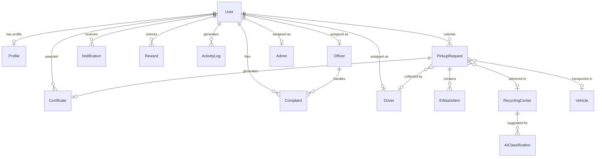

# 05 — Database Schema Architecture & Data Model Reference

**Project**: EcoRoute — AI-Powered Scrap Marketplace  
**Milestone**: Review 3 Comprehensive Database Documentation  
**Primary Database Schema**: PostgreSQL via Prisma ORM (`prisma/schema.prisma`)  
**Supabase Schema & Security Layer**: PostgreSQL DDL & Row Level Security (`supabase/schema.sql`)  

---

## 1. Database Architecture Overview

EcoRoute utilizes a relational PostgreSQL data model orchestrated via **Prisma ORM** (7.9.1) and **Supabase**. The schema supports:
- **Strict Role-Based Access Control (RBAC)** across four core actors: `CITIZEN`, `RECYCLER` (Scrap Dealer), `OFFICER` (CPCB Inspector), and `ADMIN` (Central Regulator).
- **Physical Tracking & Doorstep Pickup Chain-of-Custody**: From household request submission to driver vehicle assignment, scrap collection, center delivery, and certified recycling.
- **Marketplace Scrap Listings & Valuation**: AI visual appraisal records, item authenticity scores, price baselines, and seller GPS coordinates.
- **Auditing & Statutory Compliance**: CPCB e-waste management rules, activity logs, green recycling certificates with verified CO2 offset figures.

---

## 2. Prisma Relational Models (`prisma/schema.prisma`)

The Prisma schema defines **16 Relational Models** mapped to PostgreSQL tables (`@@map`):



### 1. `User` (Table: `users`)
- **Purpose**: Core authentication entity for citizens, dealers, officers, and administrators.
- **Primary Key**: `id` (`String @id @default(uuid())`)
- **Key Fields**:
  - `email` (`String @unique`): Unique login identifier.
  - `passwordHash` (`String`): Bcrypt salted hash (10 rounds).
  - `role` (`Role @default(CITIZEN)`): Enum (`CITIZEN`, `OFFICER`, `ADMIN`).
  - `verified` (`Boolean @default(false)`): Email verification flag.
  - `verificationToken`, `resetToken`, `resetTokenExpiry`: Password recovery tokens.
- **Relations**: 1-to-1 with `Profile`, `Driver`, `Officer`, `Admin`; 1-to-many with `PickupRequest`, `Notification`, `Reward`, `Certificate`, `Complaint`, `ActivityLog`.

### 2. `Profile` (Table: `profiles`)
- **Purpose**: Citizen identity, contact numbers, and KYC linkage.
- **Primary Key**: `id` (`String @id @default(uuid())`)
- **Foreign Key**: `userId` (`String @unique`, references `User.id` with `onDelete: Cascade`).
- **Key Fields**: `fullName`, `phone`, `address`, `city`, `state`, `pinCode`, `citizenId` (`@unique`), `aadhaarLinked` (`Boolean`), `avatarUrl`.

### 3. `PickupRequest` (Table: `pickup_requests`)
- **Purpose**: Represents a doorstep scrap collection transaction.
- **Primary Key**: `id` (`String @id @default(uuid())`)
- **Key Fields**:
  - `requestId` (`String @unique`): User-facing tracking token (e.g. `REQ-2026-8812`).
  - `status` (`PickupStatus @default(SUBMITTED)`): Enum (`SUBMITTED`, `APPROVED`, `ASSIGNED`, `COLLECTED`, `DELIVERED`, `RECYCLED`, `COMPLETED`, `CANCELLED`).
  - `priority` (`Priority @default(NORMAL)`): Enum (`NORMAL`, `HIGH`, `URGENT`, `CRITICAL`).
  - `hazardLevel` (`HazardLevel @default(LOW)`): Enum (`LOW`, `MODERATE`, `HIGH`, `CRITICAL`).
  - `pickupDate`, `timeSlot`, `estimatedWeight`, `rewardPoints`, `address`, `city`, `district`, `pinCode`.
- **Foreign Keys**:
  - `userId` (references `User.id`)
  - `centerId` (references `RecyclingCenter.id`)
  - `driverId` (references `Driver.id`)
  - `vehicleId` (references `Vehicle.id`)

### 4. `EWasteItem` (Table: `ewaste_items`)
- **Purpose**: Individual scrap or electronic device items bundled within a pickup request.
- **Primary Key**: `id` (`String @id @default(uuid())`)
- **Foreign Key**: `pickupRequestId` (references `PickupRequest.id` with `onDelete: Cascade`).
- **Key Fields**: `deviceName`, `brand`, `category`, `condition`, `estimatedAge`, `description`, `imageUrl`.

### 5. `RecyclingCenter` (Table: `recycling_centers`)
- **Purpose**: CPCB-registered recycling facilities and scrap aggregation yards.
- **Primary Key**: `id` (`String @id @default(uuid())`)
- **Key Fields**: `name`, `registrationNo` (`@unique`), `address`, `city`, `latitude`, `longitude`, `capacityTonnes`, `monthlyLoadTonnes`, `todayLoadKg`, `rating`, `status`.

### 6. `Vehicle` (Table: `vehicles`)
- **Purpose**: Light Commercial Vehicles (e.g. EV Vans / Tata Ace mini-trucks) for multi-stop collection.
- **Primary Key**: `id` (`String @id @default(uuid())`)
- **Foreign Key**: `assignedDriverId` (`String? @unique`, references `Driver.id`).
- **Key Fields**: `vehicleNumber` (`@unique`), `type`, `district`, `currentRoute`, `batteryFuelPercent`, `status` (`Idle`, `En Route`).

### 7. `Driver` (Table: `drivers`)
- **Purpose**: Collection van operators navigating clustered pickup routes.
- **Primary Key**: `id` (`String @id @default(uuid())`)
- **Foreign Key**: `userId` (`String @unique`, references `User.id` with `onDelete: Cascade`).
- **Key Fields**: `driverName`, `phone`, `district`, `availability`, `assignedPickupsCount`, `completedToday`.

### 8. `Officer` (Table: `officers`)
- **Purpose**: Central/State Pollution Control Board regional inspection officers.
- **Primary Key**: `id` (`String @id @default(uuid())`)
- **Foreign Key**: `userId` (references `User.id`).
- **Key Fields**: `officerCode` (`@unique`), `department`, `dutyZone`, `status`.

### 9. `Admin` (Table: `admins`)
- **Purpose**: CPCB Nodal Directors and central platform administrators.
- **Primary Key**: `id` (`String @id @default(uuid())`)
- **Foreign Key**: `userId` (references `User.id`).
- **Key Fields**: `adminCode` (`@unique`), `roleTitle`, `department`.

### 10. `Notification` (Table: `notifications`)
- **Purpose**: User notifications (pickup alerts, dealer bids, system notices).
- **Primary Key**: `id` (`String @id @default(uuid())`)
- **Foreign Key**: `userId` (references `User.id`).
- **Key Fields**: `title`, `message`, `type` (Enum `PICKUP`, `NOTICE`, `REWARD`, `REMINDER`, `SYSTEM`), `read`, `actionUrl`.

### 11. `Reward` (Table: `rewards`)
- **Purpose**: Gamified EcoCoins vouchers, discounts, and milestone badges.
- **Primary Key**: `id` (`String @id @default(uuid())`)
- **Foreign Key**: `userId` (references `User.id`).
- **Key Fields**: `title`, `description`, `iconName`, `pointsRequired`, `progressPercent`, `isUnlocked`, `unlockedAt`.

### 12. `Certificate` (Table: `certificates`)
- **Purpose**: Official CPCB Green Disposal Certificate with verified environmental impact metrics.
- **Primary Key**: `id` (`String @id @default(uuid())`)
- **Foreign Keys**: `userId` (references `User.id`), `pickupRequestId` (`@unique`, references `PickupRequest.id`).
- **Key Fields**: `certificateNo` (`@unique`), `issueDate`, `recycledDevice`, `weightKg`, `co2SavedKg`, `recyclerName`, `cpbLicenseNo`, `downloadUrl`.

### 13. `Complaint` (Table: `complaints`)
- **Purpose**: Citizen grievances regarding uncalibrated scales, illegal dumping, or delayed collection.
- **Primary Key**: `id` (`String @id @default(uuid())`)
- **Foreign Keys**: `userId` (references `User.id`), `assignedOfficerId` (references `Officer.id`).
- **Key Fields**: `complaintId` (`@unique`), `category`, `priority`, `status` (`OPEN`, `IN_PROGRESS`, `RESOLVED`, `ESCALATED`), `description`.

### 14. `Announcement` (Table: `announcements`)
- **Purpose**: Regulatory directives and public awareness notices.
- **Primary Key**: `id` (`String @id @default(uuid())`)
- **Key Fields**: `title`, `category`, `target`, `description`, `dateText`.

### 15. `AIClassification` (Table: `ai_classifications`)
- **Purpose**: Telemetry audit store of computer vision classifications and hazard ratings.
- **Primary Key**: `id` (`String @id @default(uuid())`)
- **Foreign Key**: `suggestedCenterId` (references `RecyclingCenter.id`).
- **Key Fields**: `imageUrl`, `deviceCategory`, `confidenceScore`, `estimatedValue`, `hazardLevel`, `hazardDescription`, `disposalRecommendation`.

### 16. `ActivityLog` (Table: `activity_logs`)
- **Purpose**: Tamper-evident security audit log tracking user logins, role changes, and administrative actions.
- **Primary Key**: `id` (`String @id @default(uuid())`)
- **Foreign Key**: `userId` (`String?`, references `User.id` with `onDelete: SetNull`).
- **Key Fields**: `action`, `details`, `ipAddress`, `createdAt`.

---

## 3. Supabase Schema & Row Level Security (RLS) Layer (`supabase/schema.sql`)

The repository includes a dedicated `supabase/schema.sql` script specifically designed for execution in the Supabase PostgreSQL SQL Editor.

### Tables Defined in `supabase/schema.sql`:
1. `public.users`: Core authentication table with custom `user_role` enum (`CITIZEN`, `RECYCLER`, `OFFICER`, `ADMIN`).
2. `public.profiles`: Citizen personal profiles with Aadhaar linkage flags.
3. `public.recycler_profiles`: Verified scrap dealer yard details, CPCB license, shop GPS coordinates, and accepted materials array (`accepted_ewaste TEXT[]`).
4. `public.ewaste_listings`: Live marketplace listings with device name, condition, price, weight, seller contacts, and listing status (`AVAILABLE`, `BID_RECEIVED`, `SOLD`, `GOV_RESERVED`).

### Indexes for Performance:
- `idx_users_email` on `public.users(email)`
- `idx_ewaste_category` on `public.ewaste_listings(category)`
- `idx_ewaste_status` on `public.ewaste_listings(status)`
- `idx_recycler_city` on `public.recycler_profiles(city)`

### Row Level Security (RLS) Policies:
- **`public.ewaste_listings`**:
  - `SELECT`: `CREATE POLICY "Allow public read active listings" ON public.ewaste_listings FOR SELECT USING (true);`
  - `INSERT`: `CREATE POLICY "Allow authenticated insert listings" ON public.ewaste_listings FOR INSERT WITH CHECK (true);`
- **`public.users`**:
  - `SELECT`: `CREATE POLICY "Allow public read users" ON public.users FOR SELECT USING (true);`
  - `INSERT`: `CREATE POLICY "Allow public insert users" ON public.users FOR INSERT WITH CHECK (true);`
- **`public.profiles` & `public.recycler_profiles`**:
  - Public read and insert policies configured for decentralized onboarding.

---

## 4. Setup, Migration & Prisma Configuration

### Prisma 7 Configuration
In Prisma 7, connection URLs for database migrations must be specified in `prisma.config.ts` or passed via an adapter to `new PrismaClient({ adapter })`.

### Initializing Database Migrations:
```bash
# Generate Prisma Client TypeScript definitions
npx prisma generate

# Execute Supabase Schema Setup:
# Copy and execute supabase/schema.sql in the Supabase SQL Editor dashboard.
```
