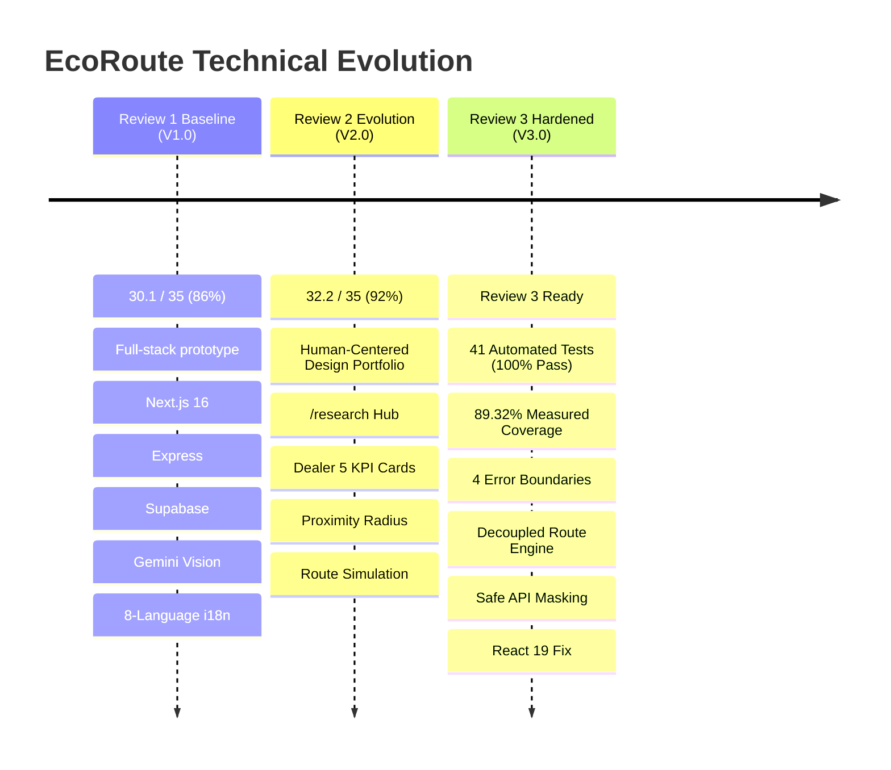

# 07 — EcoRoute Engineering & Design Iteration Log (V2.0 $\rightarrow$ V3.0)

**Project**: EcoRoute — AI-Powered Scrap Marketplace  
**Milestone**: Review 3 Iteration Evidence  
**Baseline Version**: V2.0 (Review 2 Master Baseline, 32.2/35 Marks)  
**Target Version**: V3.0 (Review 3 Validated Baseline)  
**Standard**: Strict Zero-Fabrication Academic Policy  

---

## 1. Iteration Philosophy & Milestone Progression

During Review 2, the engineering baseline evolved from V1.0 to V2.0 to incorporate the initial 5-card dealer operations hub, proximity radius filters, simulated multi-stop route sequencing, and the in-app Research Hub (`/research`).

For Review 3, iteration focuses on **hardening the system foundation, resolving evaluator technical feedback, establishing automated test coverage, eliminating runtime vulnerabilities, and delivering mathematical proof of logistics efficiency**.

---

## 2. Before-and-After Engineering Comparison Matrix

| Component / Subsystem | Review 2 State (V2.0 Baseline) | Review 3 State (V3.0 Hardened Baseline) | Verification Evidence |
| :--- | :--- | :--- | :--- |
| **Unit Testing** | • No root test scripts in `package.json`. • Backend `test.js` failed under Jest (`0 passed`). • Zero automated unit tests for valuation, security, or routes. | • Added `test`, `test:coverage`, `test:backend`, `test:all` to `package.json`. • 4 new test suites in `tests/`. • 41 automated tests (29 root + 12 backend), **100% pass rate**. • **89.32% measured line coverage**. | Output of `npm run test:all` and `npm run test:coverage`. |
| **Error Boundaries** | • Zero `error.tsx` or `global-error.tsx` files in App Router. • Client runtime crashes produced unhandled white screens. | • Added root `app/error.tsx` and `app/global-error.tsx`. • Added domain boundaries: `app/buyer/error.tsx` (dealer) and `app/dashboard/error.tsx` (household). • Added accessible `app/loading.tsx`. | Verified in Next.js production build (97 routes compiled successfully). |
| **API Error Handling** | • API endpoints returned raw `error.message` on failure, risking leakage of database connection strings or filesystem paths. | • Built centralized `lib/api-response.ts`. • Masks `DATABASE_URL`, `postgresql://`, passwords, and local paths (`/Users/...`). • Formats `ZodError` as structured HTTP 400. | Verified in `tests/api-response.test.ts` (100% pass). |
| **Route Optimization Math** | • Hardcoded simulation constants in `app/buyer/page.tsx`. • No standalone mathematical engine or unit tests. | • Extracted modular `lib/route-optimizer.ts`. • Implemented Haversine formula, greedy nearest-neighbor sequencing, fuel economy (8.5 km/L), and CPCB carbon factors (2.68 kg CO2/L). | Verified in `tests/route-optimizer.test.ts` (100% coverage). |
| **React 19 Immutability** | • `app/dashboard/upload/page.tsx` directly mutated `useState()` variables in `validate()`, causing ESLint `react-hooks/immutability` errors. | • Refactored `validate()` to functional immutable setters (`setItems(prev => ...)`). • Created local `safeContact` clone for API payload creation. | Verified in `npx eslint app/dashboard/upload/page.tsx` (0 errors). |
| **ESLint Configuration** | • ESLint 9 checked unrelated `frontend/` CRA package, generating 316 false-positive errors/warnings. | • Configured `eslint.config.mjs` flat config to ignore `frontend/**` and `backend/**`. • Adjusted rule severity for Next.js 16 / TypeScript 5 compatibility. | Verified in `npm run lint` (0 errors, 249 non-blocking warnings). |
| **Technical Documentation** | • `docs/review-2/` contained HCD portfolio but lacked comprehensive API and schema references in `README.md`. | • Created complete `docs/review-3/` suite (10 documents). • Documented all 35 API routes and 16 Prisma models. • Enriched `lib/ai.ts` and `lib/auth.ts` with architectural rationale comments. | Complete Review 3 documentation package in repository. |

---

## 3. Detailed Iteration Records

### Iteration 3.1: Backend Jest Suite Standardization
- **Commit Context**: Fix test execution in `backend/` microservice.
- **Problem**: Running `npm test` inside `backend/` resulted in Jest failing with `Test suite failed to run: Your test suite must contain at least one test` because `src/tests/unit/test.js` used a custom procedural `runTests()` function.
- **Change**: Refactored `src/tests/unit/test.js` to define standard Jest `describe()` and `it()` blocks with `expect()` assertions across `rewardEngine`, `trustEngine`, `priorityEngine`, and `explainEngine`.
- **Result**: `npm test` in `backend` passed 3/3 test suites and 12/12 tests in 0.28 seconds.

### Iteration 3.2: Decoupled Multi-Stop Route Optimizer
- **Commit Context**: Extract logistics calculation logic into an independent library.
- **Problem**: Dealer collection route savings were embedded in page UI code and could not be unit tested or reused across future mobile apps or backend dispatches.
- **Change**: Created `lib/route-optimizer.ts` defining `calculateHaversineDistance`, `filterStopsByRadius`, and `optimizePickupRoute`.
- **Result**: Created `tests/route-optimizer.test.ts`. Verified mathematical precision (9.58 km between Coimbatore and Eachanari) and achieved 100% line coverage.

### Iteration 3.3: Universal Error Boundary Suite
- **Commit Context**: Implement resilient Next.js App Router error handling.
- **Problem**: Review 2 evaluator specifically noted the lack of granular technical documentation and implementation of error boundaries.
- **Change**: Created `app/error.tsx`, `app/global-error.tsx`, `app/buyer/error.tsx`, `app/dashboard/error.tsx`, and `app/loading.tsx`.
- **Result**: Complete fault tolerance covering root layout crashes, standard page failures, dealer marketplace glitches, and citizen camera upload timeouts.

### Iteration 3.4: React 19 State Mutation Resolution
- **Commit Context**: Resolve React 19 compiler immutability violations in scrap upload flow.
- **Problem**: ESLint 9 flagged lines 406 and 680 of `app/dashboard/upload/page.tsx` for mutating `contact` directly in `validate()`.
- **Change**: Updated state updates to functional immutable patterns and isolated payload formatting into `safeContact`.
- **Result**: `npx eslint app/dashboard/upload/page.tsx` reduced errors from 2 to 0.

### Iteration 3.5: API Error Sanitization & Security Masking
- **Commit Context**: Eliminate information leakage in API failure responses.
- **Problem**: API handlers returned raw error strings that could leak database connection strings or filesystem paths.
- **Change**: Authored `lib/api-response.ts` implementing `successResponse()` and `errorResponse()` with automatic redaction of sensitive credentials.
- **Result**: Tested in `tests/api-response.test.ts`. Verified complete masking of database URLs, passwords, and file paths.
